# Study Templates

Templates for studying chess by hand — blank boards paired with room to write, so a
position and the notes about it live on the same page.

Each one is a single-page PDF, in three board views and three page sizes — or take the
whole set as one file. Drop one in as a page background and annotate it, or
print it.

[](LICENSE)

**[Browse and filter them](https://fcardinaux.github.io/study-templates/)** — pick a
layout, a board view and a page size, and download just those.
**[Download the whole set](https://github.com/fcardinaux/study-templates/releases/latest)**
— every PDF in one archive. Or pick the ones you want below.

---

## Views

Every template with a full-size board comes three ways. The squares are identical in
all of them — only the labelling changes. (The scoresheet is the exception: its
diagrams are too small to label, so it comes coordinate-free only.)

| View | Bottom-left square | For |
| --- | --- | --- |
| **White view** | a1 | Studying from White's side, the usual choice |
| **Black view** | h8 | Studying from Black's side, so the board matches what you see |
| **No coordinates** | — | Visualisation and blindfold work, or an uncluttered diagram |

And three page sizes: **3:4** for a tablet note app, **A4** and **US Letter** for paper.

## Chess

### One board, notes below

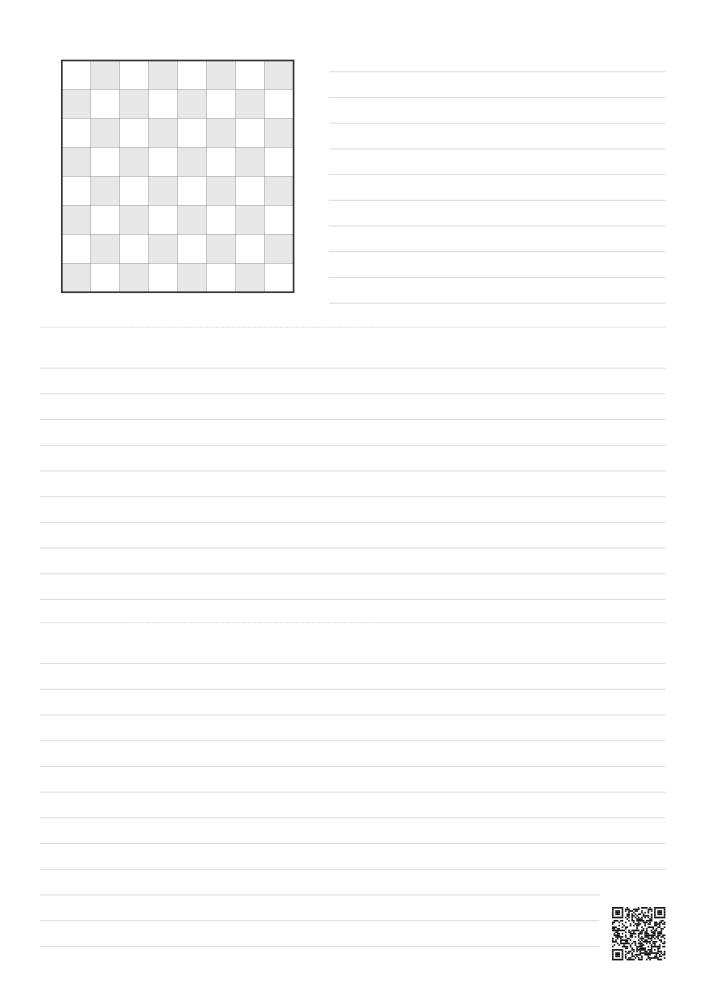

A single board in the top-left corner, ruled lines to its right, and the rest of the
page ruled edge to edge. The most writing space of the set — for annotating one
position in depth: a game you are reviewing, a tactic you missed, an endgame you want
to reason through.

**Download**

- **3:4** — [white view](pdf/chess-1-board-top-left-white-view-3x4.pdf) · [black view](pdf/chess-1-board-top-left-black-view-3x4.pdf) · [no coordinates](pdf/chess-1-board-top-left-no-coords-3x4.pdf)
- **A4** — [white view](pdf/chess-1-board-top-left-white-view-a4.pdf) · [black view](pdf/chess-1-board-top-left-black-view-a4.pdf) · [no coordinates](pdf/chess-1-board-top-left-no-coords-a4.pdf)
- **US Letter** — [white view](pdf/chess-1-board-top-left-white-view-letter.pdf) · [black view](pdf/chess-1-board-top-left-black-view-letter.pdf) · [no coordinates](pdf/chess-1-board-top-left-no-coords-letter.pdf)

### One board top right, notes below

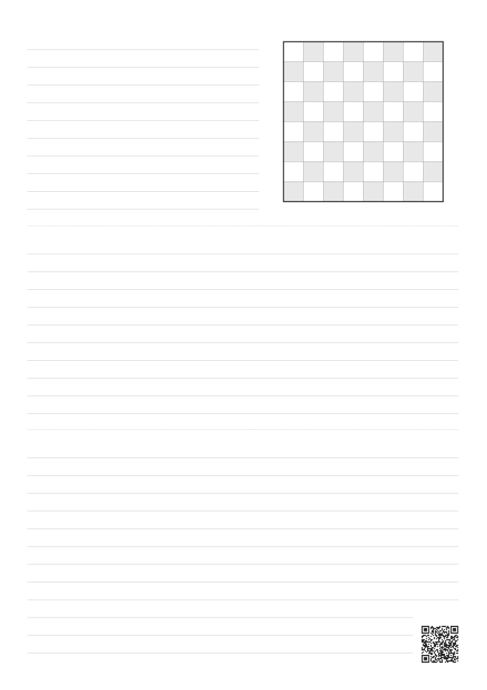

The mirror image of the page above: the board in the top-right corner and the lines
beside it on the left, for anyone who would rather have the board on the right.

**Download**

- **3:4** — [white view](pdf/chess-1-board-top-right-white-view-3x4.pdf) · [black view](pdf/chess-1-board-top-right-black-view-3x4.pdf) · [no coordinates](pdf/chess-1-board-top-right-no-coords-3x4.pdf)
- **A4** — [white view](pdf/chess-1-board-top-right-white-view-a4.pdf) · [black view](pdf/chess-1-board-top-right-black-view-a4.pdf) · [no coordinates](pdf/chess-1-board-top-right-no-coords-a4.pdf)
- **US Letter** — [white view](pdf/chess-1-board-top-right-white-view-letter.pdf) · [black view](pdf/chess-1-board-top-right-black-view-letter.pdf) · [no coordinates](pdf/chess-1-board-top-right-no-coords-letter.pdf)


### Three boards, left column

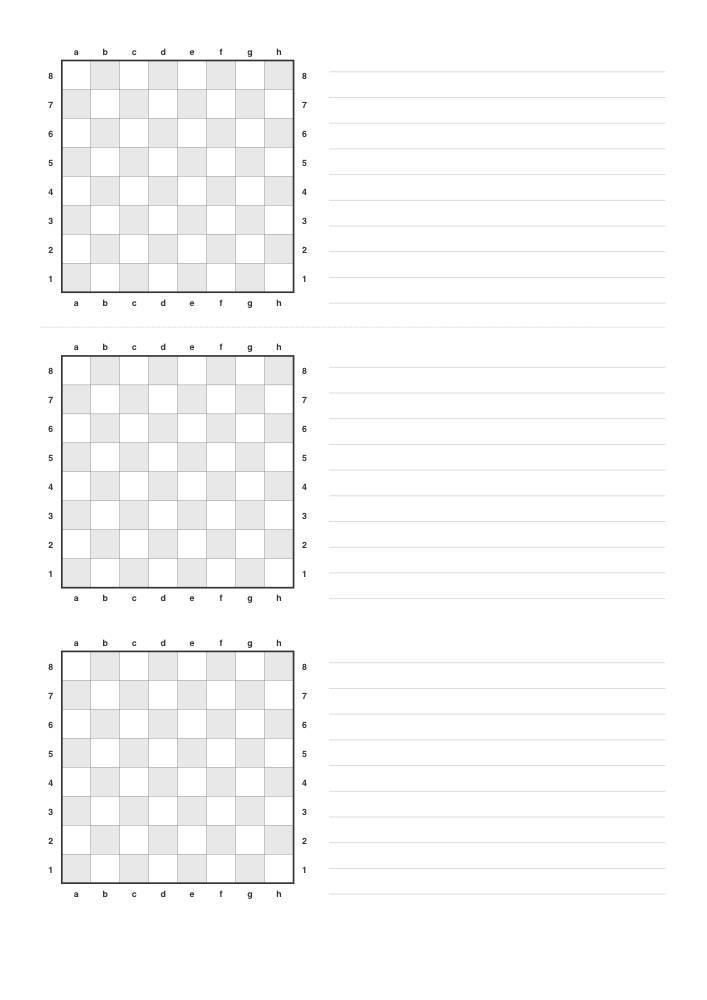

Three boards stacked down the left margin, each with its own block of ruled lines.
A steady left-to-right rhythm — diagram, then commentary — that suits three related
positions: an opening line at three branch points, or three puzzles in a row.

**Download**

- **3:4** — [white view](pdf/chess-3-boards-left-white-view-3x4.pdf) · [black view](pdf/chess-3-boards-left-black-view-3x4.pdf) · [no coordinates](pdf/chess-3-boards-left-no-coords-3x4.pdf)
- **A4** — [white view](pdf/chess-3-boards-left-white-view-a4.pdf) · [black view](pdf/chess-3-boards-left-black-view-a4.pdf) · [no coordinates](pdf/chess-3-boards-left-no-coords-a4.pdf)
- **US Letter** — [white view](pdf/chess-3-boards-left-white-view-letter.pdf) · [black view](pdf/chess-3-boards-left-black-view-letter.pdf) · [no coordinates](pdf/chess-3-boards-left-no-coords-letter.pdf)

### Three boards, right column

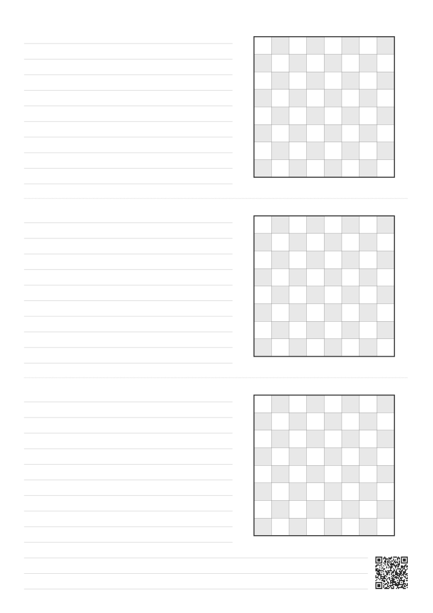

The same three boards stacked down the right margin instead, each with its block of
ruled lines to its left.

**Download**

- **3:4** — [white view](pdf/chess-3-boards-right-white-view-3x4.pdf) · [black view](pdf/chess-3-boards-right-black-view-3x4.pdf) · [no coordinates](pdf/chess-3-boards-right-no-coords-3x4.pdf)
- **A4** — [white view](pdf/chess-3-boards-right-white-view-a4.pdf) · [black view](pdf/chess-3-boards-right-black-view-a4.pdf) · [no coordinates](pdf/chess-3-boards-right-no-coords-a4.pdf)
- **US Letter** — [white view](pdf/chess-3-boards-right-white-view-letter.pdf) · [black view](pdf/chess-3-boards-right-black-view-letter.pdf) · [no coordinates](pdf/chess-3-boards-right-no-coords-letter.pdf)


### Three boards, alternating

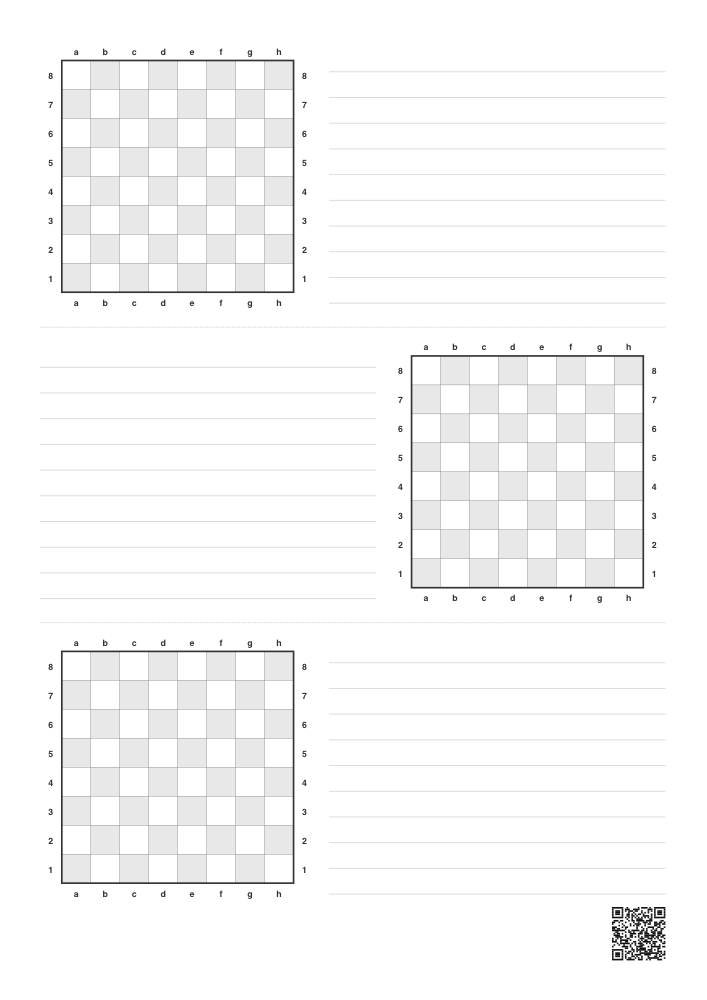

The same three boards, alternating left–right–left down the page. The zig-zag makes
each position visually distinct from its neighbours, which helps when the three are
*not* a sequence but separate items you will scan back through later.

**Download**

- **3:4** — [white view](pdf/chess-3-boards-alternate-white-view-3x4.pdf) · [black view](pdf/chess-3-boards-alternate-black-view-3x4.pdf) · [no coordinates](pdf/chess-3-boards-alternate-no-coords-3x4.pdf)
- **A4** — [white view](pdf/chess-3-boards-alternate-white-view-a4.pdf) · [black view](pdf/chess-3-boards-alternate-black-view-a4.pdf) · [no coordinates](pdf/chess-3-boards-alternate-no-coords-a4.pdf)
- **US Letter** — [white view](pdf/chess-3-boards-alternate-white-view-letter.pdf) · [black view](pdf/chess-3-boards-alternate-black-view-letter.pdf) · [no coordinates](pdf/chess-3-boards-alternate-no-coords-letter.pdf)

### Three boards, alternating from the right

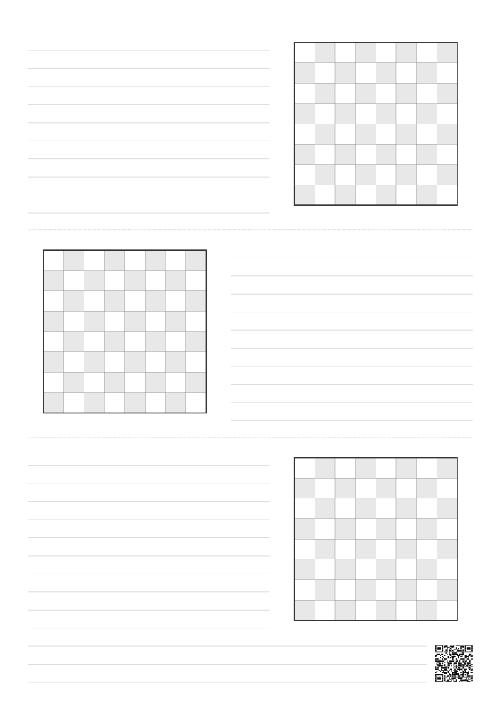

The alternating page started from the other side: right–left–right.

**Download**

- **3:4** — [white view](pdf/chess-3-boards-alternate-right-first-white-view-3x4.pdf) · [black view](pdf/chess-3-boards-alternate-right-first-black-view-3x4.pdf) · [no coordinates](pdf/chess-3-boards-alternate-right-first-no-coords-3x4.pdf)
- **A4** — [white view](pdf/chess-3-boards-alternate-right-first-white-view-a4.pdf) · [black view](pdf/chess-3-boards-alternate-right-first-black-view-a4.pdf) · [no coordinates](pdf/chess-3-boards-alternate-right-first-no-coords-a4.pdf)
- **US Letter** — [white view](pdf/chess-3-boards-alternate-right-first-white-view-letter.pdf) · [black view](pdf/chess-3-boards-alternate-right-first-black-view-letter.pdf) · [no coordinates](pdf/chess-3-boards-alternate-right-first-no-coords-letter.pdf)


### Cornell layout, dot grid

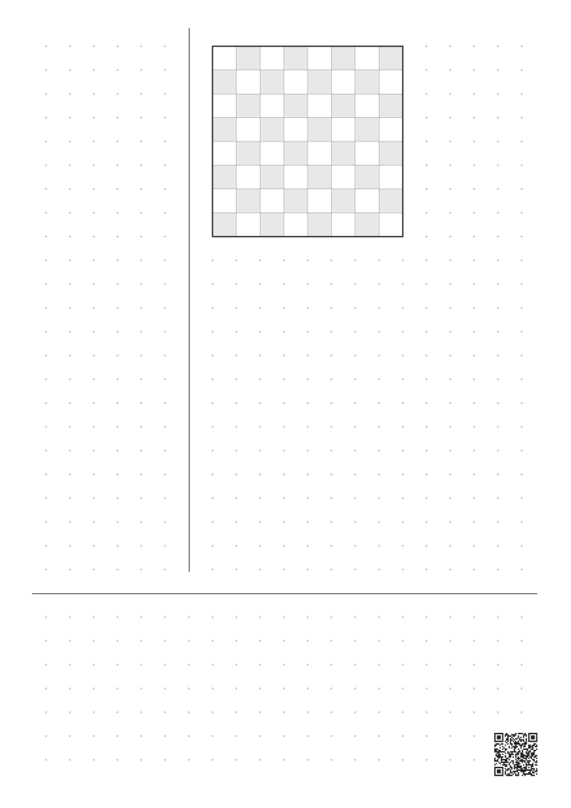

The [Cornell note-taking layout](#about-the-cornell-layout) adapted for chess: a narrow
cue column on the left for questions and keywords, the board at the top of the main
column, and a summary band ruled off at the foot of the page. One grid runs across the
whole page, anchored on the crossing of the two rules, and the board's squares are
exactly one grid cell — so the dots, the rules and the board all line up.

**Download**

- **3:4** — [white view](pdf/chess-cornell-dots-white-view-3x4.pdf) · [black view](pdf/chess-cornell-dots-black-view-3x4.pdf) · [no coordinates](pdf/chess-cornell-dots-no-coords-3x4.pdf)
- **A4** — [white view](pdf/chess-cornell-dots-white-view-a4.pdf) · [black view](pdf/chess-cornell-dots-black-view-a4.pdf) · [no coordinates](pdf/chess-cornell-dots-no-coords-a4.pdf)
- **US Letter** — [white view](pdf/chess-cornell-dots-white-view-letter.pdf) · [black view](pdf/chess-cornell-dots-black-view-letter.pdf) · [no coordinates](pdf/chess-cornell-dots-no-coords-letter.pdf)

### Cornell layout, cue column right, dot grid

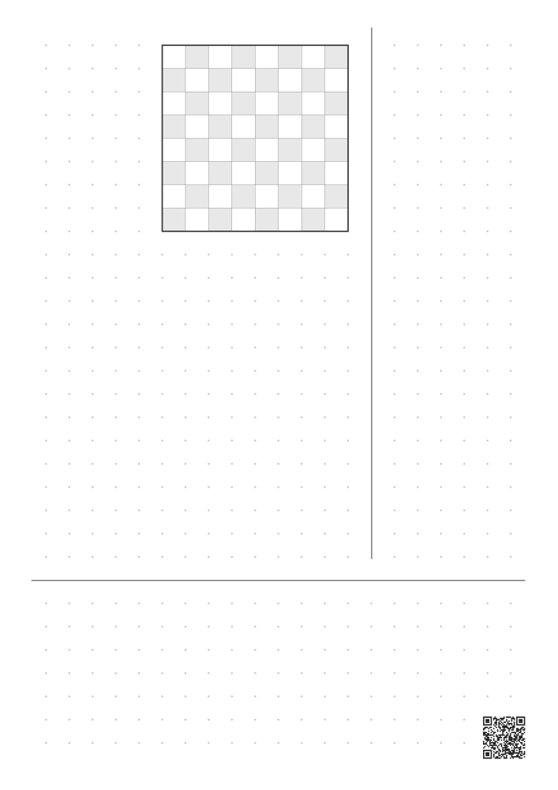

The dot-grid Cornell page in mirror image: the cue column on the right, the board
against the divider on its left. The grid and the board line up exactly as they do
above.

**Download**

- **3:4** — [white view](pdf/chess-cornell-dots-cue-right-white-view-3x4.pdf) · [black view](pdf/chess-cornell-dots-cue-right-black-view-3x4.pdf) · [no coordinates](pdf/chess-cornell-dots-cue-right-no-coords-3x4.pdf)
- **A4** — [white view](pdf/chess-cornell-dots-cue-right-white-view-a4.pdf) · [black view](pdf/chess-cornell-dots-cue-right-black-view-a4.pdf) · [no coordinates](pdf/chess-cornell-dots-cue-right-no-coords-a4.pdf)
- **US Letter** — [white view](pdf/chess-cornell-dots-cue-right-white-view-letter.pdf) · [black view](pdf/chess-cornell-dots-cue-right-black-view-letter.pdf) · [no coordinates](pdf/chess-cornell-dots-cue-right-no-coords-letter.pdf)


### Cornell layout, crosshair grid

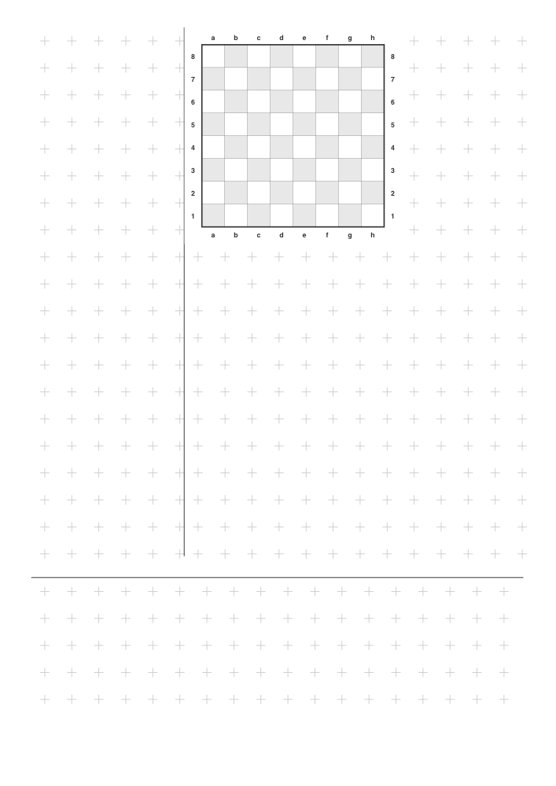

The same Cornell layout, and the same grid, with a crosshair in place of each dot. The
ticks give you horizontal and vertical alignment cues rather than single points — easier
to rule a straight line or draw a second board freehand, slightly busier on the page.

**Download**

- **3:4** — [white view](pdf/chess-cornell-crosshairs-white-view-3x4.pdf) · [black view](pdf/chess-cornell-crosshairs-black-view-3x4.pdf) · [no coordinates](pdf/chess-cornell-crosshairs-no-coords-3x4.pdf)
- **A4** — [white view](pdf/chess-cornell-crosshairs-white-view-a4.pdf) · [black view](pdf/chess-cornell-crosshairs-black-view-a4.pdf) · [no coordinates](pdf/chess-cornell-crosshairs-no-coords-a4.pdf)
- **US Letter** — [white view](pdf/chess-cornell-crosshairs-white-view-letter.pdf) · [black view](pdf/chess-cornell-crosshairs-black-view-letter.pdf) · [no coordinates](pdf/chess-cornell-crosshairs-no-coords-letter.pdf)

### Cornell layout, cue column right, crosshair grid

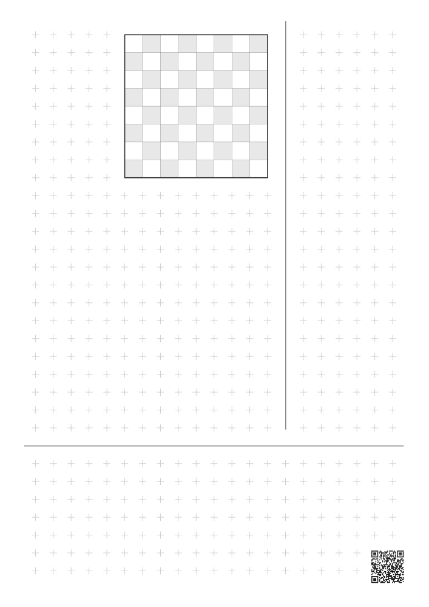

The crosshair Cornell page with the cue column on the right.

**Download**

- **3:4** — [white view](pdf/chess-cornell-crosshairs-cue-right-white-view-3x4.pdf) · [black view](pdf/chess-cornell-crosshairs-cue-right-black-view-3x4.pdf) · [no coordinates](pdf/chess-cornell-crosshairs-cue-right-no-coords-3x4.pdf)
- **A4** — [white view](pdf/chess-cornell-crosshairs-cue-right-white-view-a4.pdf) · [black view](pdf/chess-cornell-crosshairs-cue-right-black-view-a4.pdf) · [no coordinates](pdf/chess-cornell-crosshairs-cue-right-no-coords-a4.pdf)
- **US Letter** — [white view](pdf/chess-cornell-crosshairs-cue-right-white-view-letter.pdf) · [black view](pdf/chess-cornell-crosshairs-cue-right-black-view-letter.pdf) · [no coordinates](pdf/chess-cornell-crosshairs-cue-right-no-coords-letter.pdf)


### Scoresheet

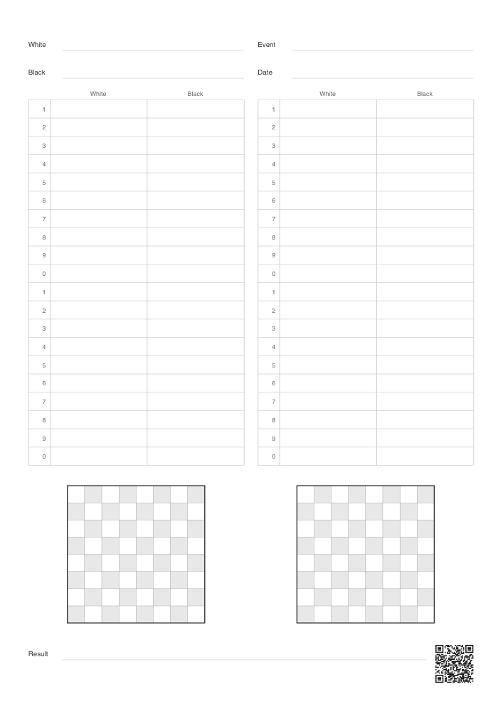

For recording a game rather than annotating a position. Two columns of numbered
move rows, and a board at the foot of each column, big enough to actually write a
position into — about 7mm a square on A4 and 9mm on the other two sizes.

The move numbers print **only their last digit**: 1 to 9, then 0, then 1 again.
One sheet therefore serves any stretch of a game. Write the tens digit in by hand
beside each 0 — a 1 for the teens, a 2 for the twenties — and the second sheet of
a long game is this same sheet again, not a different one.

A page always holds a whole number of tens, so the next sheet starts on a 1 just
as this one does: 40 moves on A4, 30 on the shorter pages, which take fewer rows
rather than smaller boards. The result goes at the foot, where you reach it last.

The boards carry no coordinates — a position written into one needs the squares,
not labels around them — so this is the one template that comes coordinate-free
only.

**Download** — [3:4](pdf/chess-scoresheet-no-coords-3x4.pdf) · [A4](pdf/chess-scoresheet-no-coords-a4.pdf) · [US Letter](pdf/chess-scoresheet-no-coords-letter.pdf)

### All in one file

Every layout above, in the same order, as a single eleven-page PDF — one import
instead of eleven. These are in addition to the files above, not a replacement: the
single-layout files are still there if you only want one.

**Download**

- **3:4** — [white view](pdf/chess-all-layouts-white-view-3x4.pdf) · [black view](pdf/chess-all-layouts-black-view-3x4.pdf) · [no coordinates](pdf/chess-all-layouts-no-coords-3x4.pdf)
- **A4** — [white view](pdf/chess-all-layouts-white-view-a4.pdf) · [black view](pdf/chess-all-layouts-black-view-a4.pdf) · [no coordinates](pdf/chess-all-layouts-no-coords-a4.pdf)
- **US Letter** — [white view](pdf/chess-all-layouts-white-view-letter.pdf) · [black view](pdf/chess-all-layouts-black-view-letter.pdf) · [no coordinates](pdf/chess-all-layouts-no-coords-letter.pdf)

---

## Using them in a note app

The **3:4** files are 8.00 × 10.67 inches, the proportion of a 13.3-inch e-ink panel
held upright. Import one as a page background or template and it fills the screen,
with no empty strip down either side.

Everything is drawn as vector, so the boards and grids stay sharp at any zoom and at
the 300 ppi those panels render at — nothing in these pages is a bitmap.

The A4 and Letter files work too, but neither matches those proportions, so each sits
inside the screen with a strip of empty space — down the sides for A4, which is
narrower, and above and below for Letter, which is wider.

## Printing

The **A4** files are 210 × 297 mm and the **US Letter** files 8.5 × 11 inches. Both are
native page sizes, so nothing is scaled and nothing is clipped.

Set the scale to **100%** in your print dialog — not "Fit to page" or "Shrink to
printable area". Scaling stretches the page to your printer's margins and the board
squares stop being square, which makes pieces sketched on them look lopsided.

## About the Cornell layout

Four of these templates follow the Cornell note-taking method — cue column, note-taking
area, summary — developed by Walter Pauk at Cornell University in the 1950s. The method
is used here on its merits as a note-taking structure.

These templates are not affiliated with, endorsed by, or connected to Cornell University.

## How these were made

Designed by [François Cardinaux](https://github.com/fcardinaux). The first generation
was produced with Google Gemini as HTML and CSS and printed to PDF from Chrome; the
PDFs are now generated from the source in `src/`.

## Building from source

Every PDF in this repository is generated. To change a template, edit the source and
rebuild — do not edit the PDFs.

```
./build.sh
```

That regenerates every PDF and refreshes the preview images. It needs Chrome
(set `CHROME=/path/to/chrome` if yours is not in the usual place) and Python 3,
which serves the sources locally because browsers will not load ES modules over
`file://`.

| File | What it holds |
| --- | --- |
| `src/lib.js` | The board, the ruled lines, the text, and the dot and crosshair grids |
| `src/layouts.js` | The page layouts, and every measurement they share |
| `src/qr.js` | The module matrix of the QR code, drawn as vector on every page |
| `src/render.html` | Draws one template, or all of them, at a given view and page size |
| `index.html` | The download page, which filters `catalog.json` — a list of the PDFs the build writes |
| `tests/` | Tests for the download page: `tests/run.sh` runs them in headless Chrome |

Each layout is a function of the page size, so a page of different proportions keeps
the same geometry and simply fits however many ruled lines the height allows.

The build is reproducible: rebuilding without changing the source produces the same
bytes, so any difference under `pdf/` is a real change to the artwork.

Everything is drawn as explicit SVG rather than CSS backgrounds. That matters: Chrome
rasterises a CSS gradient when it prints, which is how the original dot and crosshair
grids ended up as 72 dpi bitmaps on an otherwise vector page.

## Share

Every template carries this code in its bottom-right corner, so a page on its own —
printed, or open in a note app — still leads back to the download page.


https://fcardinaux.github.io/study-templates/ — which links back here.

## License

[Creative Commons Attribution 4.0 International](LICENSE) (CC BY 4.0).

Print them, share them, remix them, use them in a class or a coaching business — just
credit the source. Attribution suggestion:

> Study Templates by François Cardinaux — https://github.com/fcardinaux/study-templates — CC BY 4.0

One caveat, stated plainly: the layouts were produced with AI assistance, and a blank
8 × 8 grid with ruled lines is close to the floor of what copyright protects in the
first place. The licence covers whatever rights do exist in the design and arrangement,
and makes clear you are welcome to the rest.
